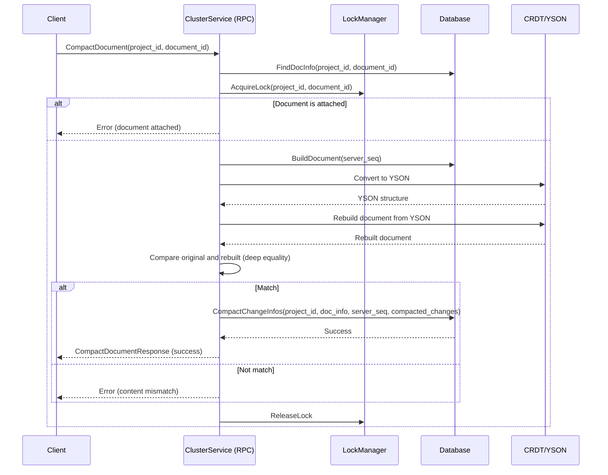

# HouseKeeping - Document Compaction

모든 코드의 파일명은 코드 최상단에 주석으로 남기거나, 코드 블럭 위에 적어 두었습니다.

# 1.  Housekeeping - Document Compaction

- introduce Issue: https://github.com/yorkie-team/yorkie/issues/1223
- PR
    - Compaction 도입: https://github.com/yorkie-team/yorkie/pull/1241
    - Housekeeping Process에 편입: https://github.com/yorkie-team/yorkie/pull/1255

**Document Compaction은** Attached된 클라이언트가 없을 때, 오래된 `changes`, `snapshots`, `versionvectors` 를 제거하는 압축 메커니즘이다.

문서의 편집이 쌓이면서 GC를 수행하지만 `changes` 는 쌓일 수 있고, 오래된`snapshots` , `versionvectors`  등도 제거해야 할 필요가 있다.

- 결론: 내가 이해한게 맞다면, **이런 Changes나 스냅샷, 버전 벡터들을 지우기 위해 최신 스냅샷과 이후 Changes들을 이용해 `InternalDocument`를 재구성하고, 필요 없어진 Changes, Snapshot, VersionVectors를 지워내는 것 같다.**

# 2. Compaction 과정 Overview

`documents.CompactDocuments` 가 호출되면 프로젝트 단위로 후보 문서를 찾고 압축 수행한다.

어디서 어떻게 호출되는지, 각 함수들의 세부 동작은 어떤지는 뒤에서 설명

```go
// 문서 압축 수행
func CompactDocuments(
    ctx context.Context,
    be *backend.Backend,
    candidatesLimitPerProject int,
    projectFetchSize int,
    compactionMinChanges int,
    lastCompactionProjectID types.ID,
) (types.ID, error) {

    // 1. 먼저 중복 compaction을 막기 위해 compactionKey로 Lock을 얻는다.
    locker, ok := be.Lockers.LockerWithTryLock(compactionKey)
    if !ok {
        return database.DefaultProjectID, nil
    }
    defer locker.Unlock()

    // 2. FindCompactionCandidates 를 통해 후보들을 찾는다.
    start := time.Now()
    lastProjectID, candidates, err := FindCompactionCandidates(
        ctx, be, candidatesLimitPerProject, projectFetchSize, compactionMinChanges, lastCompactionProjectID,
    )
    if err != nil { return database.DefaultProjectID, err }

    // 3. CompactDocument로 Compaction을 수행한다.
    compactedCount := 0
    for _, pair := range candidates {
        if err := CompactDocument(ctx, be, pair.Project.ToProject(), pair.Document); err != nil {
            continue
        }
        compactedCount++
    }

    if len(candidates) > 0 {
        logging.From(ctx).Infof("HSKP: candidates %d, compacted %d, %s", len(candidates), compactedCount, time.Since(start))
    }
    return lastProjectID, nil
}
```

1. 먼저 중복 compaction을 막기 위해 compactionKey로 Lock을 얻는다.
(이 값은 단순 상수임)
    
    ```go
    // server/documents/housekeeping.go 의 상수임
    const (
    	compactionKey = "housekeeping/compaction"
    )
    ```
    
2. `FindCompactionCandidates` 를 통해 후보들을 찾는다. (추후 설명)
3. `CompactDocument`를 호출해 Compaction을 수행한다.

## Diagram

- https://github.com/yorkie-team/yorkie/pull/1241 발췌



# 3. 후보를 찾는 과정 `FindCompactionCandidates`

1. FindNextNCyclingProjectInfos 함수를 통해
2. 프로젝트별로 Compaction 후보를 찾아낸다.
    1. TODO: 기준이 뭐지??

```go
// FindCompactionCandidates finds candidates to compact from the database.
func FindCompactionCandidates(
	ctx context.Context,
	be *backend.Backend,
	candidatesLimitPerProject int,
	projectFetchSize int,
	compactionMinChanges int,
	lastProjectID types.ID,
) (types.ID, []CandidatePair, error) {
	projectInfos, err := be.DB.FindNextNCyclingProjectInfos(ctx, projectFetchSize, lastProjectID)
	if err != nil {
		return database.DefaultProjectID, nil, err
	}

	var candidates []CandidatePair
	for _, projectInfo := range projectInfos {
		infos, err := be.DB.FindCompactionCandidatesPerProject(
			ctx,
			projectInfo,
			candidatesLimitPerProject,
			compactionMinChanges,
		)
		if err != nil {
			return database.DefaultProjectID, nil, err
		}

		for _, info := range infos {
			candidates = append(candidates, CandidatePair{
				Project:  projectInfo,
				Document: info,
			})
		}
	}

	var topProjectID types.ID
	if len(projectInfos) < projectFetchSize {
		topProjectID = database.DefaultProjectID
	} else {
		topProjectID = projectInfos[len(projectInfos)-1].ID
	}

	return topProjectID, candidates, nil
}
```

# 4. `CompactDocument` API 호출시 일어나는 일들

## 4.1 스케줄링에 의해 호출되는 부분

- cluster.connect.go → yorkie/cluster/client.go

이러한 Compaction RPC가 주어지고, 스케줄링에 의해 호출됨

```go
// cluster.connect.go
// ClusterServiceClient is a client for the yorkie.v1.ClusterService service.
type ClusterServiceClient interface {
	DetachDocument(context.Context, *connect.Request[v1.ClusterServiceDetachDocumentRequest]) (*connect.Response[v1.ClusterServiceDetachDocumentResponse], error)
	CompactDocument(context.Context, *connect.Request[v1.ClusterServiceCompactDocumentRequest]) (*connect.Response[v1.ClusterServiceCompactDocumentResponse], error)
	PurgeDocument(context.Context, *connect.Request[v1.ClusterServicePurgeDocumentRequest]) (*connect.Response[v1.ClusterServicePurgeDocumentResponse], error)
}
```

## 4.2 yorkie/cluster/client.go

- project id, document id와 document key를 통해 정확한 Document를 식별한다.

```go
// yorkie/cluster/client.go
// CompactDocument compacts the given document.
func (c *Client) CompactDocument(
	ctx context.Context,
	project *types.Project,
	docInfo *database.DocInfo,
) error {
	_, err := c.client.CompactDocument(
		ctx,
		withShardKey(connect.NewRequest(&api.ClusterServiceCompactDocumentRequest{
			ProjectId:   docInfo.ProjectID.String(),
			DocumentId:  docInfo.ID.String(),
			DocumentKey: docInfo.Key.String(),
		}), project.PublicKey, docInfo.Key.String()))
	if err != nil {
		return err
	}

	return nil
}
```

## 4.3 yorkie/server/rpc/cluster_server.go

1. document key로 lock을 잡고 문서를 식별
2. `packs.Compac` 실제 압축 수행

```go
// yorkie/server/rpc/cluster_server.go
// CompactDocument unnecessary data from the document and its metadata to reduce
// storage usage.
func (s *clusterServer) CompactDocument(
	ctx context.Context,
	req *connect.Request[api.ClusterServiceCompactDocumentRequest],
) (*connect.Response[api.ClusterServiceCompactDocumentResponse], error) {
	docId := types.ID(req.Msg.DocumentId)
	projectID := types.ID(req.Msg.ProjectId)
	docKey := key.Key(req.Msg.DocumentKey)

	// NOTE(hackerwins): This locker is used to prevent concurrent compaction
	// requests for the same document. And it is also used to prevent
	// concurrent push/pull requests while compaction is in progress.
	locker := s.backend.Lockers.Locker(packs.DocKey(projectID, docKey))
	defer locker.Unlock()

	docInfo, err := documents.FindDocInfoByRefKey(ctx, s.backend, types.DocRefKey{
		ProjectID: projectID,
		DocID:     docId,
	})
	if err != nil {
		return nil, err
	}

	if err := packs.Compact(ctx, s.backend, projectID, docInfo); err != nil {
		return nil, err
	}

	return connect.NewResponse(&api.ClusterServiceCompactDocumentResponse{}), nil
}
```

## 4.4 실제 압축이 일어나는 packs.Compact

- `yorkie/server/packs/compaction.go`
1. snapshot 캐시 무효화
2. document attached 검증 (attached인 경우 error)
3. Compacted된 Changes를 빌드하고, 이전과 동작이 같은지 확인
4. 재빌드하고, 내용이 동일한지 확인 (두번의 무결성 검증 과정이 있음)
5. 압축된 변경사항과 메타데이터를 DB에 저장

```go
// Compact compacts the given document and its metadata and stores them in the
// database.
func Compact(
	ctx context.Context,
	be *backend.Backend,
	projectID types.ID,
	docInfo *database.DocInfo,
) error {
	// 0. Invalidate snapshot cache.
	be.Cache.Snapshot.Remove(docInfo.RefKey())

	// 1. Check if the document is attached.
	isAttached, err := be.DB.IsDocumentAttached(ctx, types.DocRefKey{
		ProjectID: projectID,
		DocID:     docInfo.ID,
	}, "")
	if err != nil {
		return err
	}
	if isAttached {
		// TODO(hackerwins): ErrDocumentNotAttached exists in documents package,
		// but it can not be here because of the circular dependency.
		return fmt.Errorf("document is attached")
	}

	// 2. Build compacted changes and check if the content is the same.
	doc, err := BuildInternalDocForServerSeq(ctx, be, docInfo, docInfo.ServerSeq)
	if err != nil {
		logging.DefaultLogger().Errorf("[CD] Document %s failed to apply changes: %v\n", docInfo.ID, err)
		return err
	}

	root, err := yson.FromCRDT(doc.RootObject())
	if err != nil {
		return err
	}

	newDoc := document.New(docInfo.Key)
	if err = newDoc.Update(func(r *json.Object, p *presence.Presence) error {
		r.SetYSON(root)
		return nil
	}); err != nil {
		return err
	}

	newRoot, err := yson.FromCRDT(newDoc.RootObject())
	if err != nil {
		return err
	}

	// 3. Check if the content is the same after rebuilding.
	prevMarshalled, err := root.(yson.Object).Marshal()
	if err != nil {
		return err
	}
	newMarshalled, err := newRoot.(yson.Object).Marshal()
	if err != nil {
		return err
	}
	if prevMarshalled != newMarshalled {
		return fmt.Errorf("content mismatch after rebuild: %s", docInfo.ID)
	}

	// 4. Store compacted changes and metadata in the database.
	if err = be.DB.CompactChangeInfos(
		ctx,
		docInfo,
		docInfo.ServerSeq,
		newDoc.CreateChangePack().Changes,
	); err != nil {
		logging.DefaultLogger().Errorf(
			"[CD] Document %s failed to compact: %v\n Root: %s\n",
			docInfo.ID, err, prevMarshalled,
		)
		return err
	}

	return nil
}

```

## 4.5 빌드시엔 어떤 일이 일어나는가? `BuildInternalDocForServerSeq`

`BuildInternalDocForServerSeq` 는 가장 최신의 스냅샷과 그 이후의 변경 사항을 적용해 문서를 Build하는 것이 목적임. (`InternalDocument` 만들기)

`BuildInternalDocForServerSeq` 자체는 Document Compaction 뿐만 아니라 pushpull 과정에서도 사용된다.

- `yorkie/server/profiling`

```go
// BuildInternalDocForServerSeq returns a new document for the given serverSeq.
func BuildInternalDocForServerSeq(
	ctx context.Context,
	be *backend.Backend,
	docInfo *database.DocInfo,
	serverSeq int64,
) (*document.InternalDocument, error) {
	docKey := docInfo.RefKey()
	var doc *document.InternalDocument
	var err error
	if cached, ok := be.Cache.Snapshot.Get(docKey); ok {
		doc, err = cached.DeepCopy()
		if err != nil {
			return nil, err
		}
	}

	// NOTE(hackerwins): If the document is already in the cache, we can skip
	// the database query and use the cached document. If the document's server
	// sequence in the cache is greater than the given server sequence, we can't
	// build the document from the document. In this case, we need to
	// query the database to get the closest snapshot information.
	if doc == nil || serverSeq < doc.Checkpoint().ServerSeq {
		snapshotInfo, err := be.DB.FindClosestSnapshotInfo(
			ctx,
			docKey,
			serverSeq,
			true,
		)
		if err != nil {
			return nil, err
		}

		doc, err = document.NewInternalDocumentFromSnapshot(
			docInfo.Key,
			snapshotInfo.ServerSeq,
			snapshotInfo.Lamport,
			snapshotInfo.VersionVector,
			snapshotInfo.Snapshot,
		)
		if err != nil {
			return nil, err
		}
	}

	changes, err := be.DB.FindChangesBetweenServerSeqs(
		ctx,
		docKey,
		doc.Checkpoint().ServerSeq+1,
		serverSeq,
	)
	if err != nil {
		return nil, err
	}

	if err := doc.ApplyChangePack(change.NewPack(
		docInfo.Key,
		change.InitialCheckpoint.NextServerSeq(serverSeq),
		changes,
		nil,
		nil,
	), be.Config.SnapshotDisableGC); err != nil {
		return nil, err
	}
	if !be.Config.SnapshotDisableGC {
		vector, err := be.DB.GetMinVersionVector(
			ctx,
			docKey,
			doc.VersionVector(),
		)
		if err != nil {
			return nil, err
		}
		if _, err := doc.GarbageCollect(vector); err != nil {
			return nil, err
		}
	}

	// NOTE(hackerwins): Store the last accessed document in the cache.
	be.Cache.Snapshot.Add(docKey, doc)

	if logging.Enabled(zap.DebugLevel) {
		logging.From(ctx).Debugf(
			"after apply %d changes: elements: %d removeds: %d, %s",
			len(changes),
			doc.Root().ElementMapLen(),
			doc.Root().GarbageElementLen(),
			doc.RootObject().Marshal(),
		)
	}

	clone, err := doc.DeepCopy()
	if err != nil {
		return nil, err
	}

	return clone, nil
}
```

## 4.6 CompactChangeInfos 함수에선 무슨 일이

1. 문서 리소스 Purge
    1. `purgeDocumentInternals`에서 Changes, Snapshots, VersionVectors 삭제
2. Store compacted change and update document
    1. 최신 Document Info 조회
    2. change들을 순회하며 Operation들을 Encoding한다.
    3. 저장
3. Document(의 ServerSeq)를 업데이트한다.

```go
// CompactChangeInfos stores the given compacted changes then updates the docInfo.
func (d *DB) CompactChangeInfos(
	ctx context.Context,
	docInfo *database.DocInfo,
	lastServerSeq int64,
	changes []*change.Change,
) error {
	txn := d.db.Txn(true)
	defer txn.Abort()

	// 1. Purge the resources of the document.
	if _, err := d.purgeDocumentInternals(ctx, docInfo.ProjectID, docInfo.ID, txn); err != nil {
		return err
	}

	// 2. Store compacted change and update document
	raw, err := txn.First(
		tblDocuments,
		"project_id_id",
		docInfo.ProjectID.String(),
		docInfo.ID.String(),
	)
	if err != nil {
		return fmt.Errorf("find document: %w", err)
	}
	if raw == nil {
		return fmt.Errorf("%s: %w", docInfo.ID, database.ErrDocumentNotFound)
	}
	loadedDocInfo := raw.(*database.DocInfo).DeepCopy()
	if loadedDocInfo.ServerSeq != lastServerSeq {
		return fmt.Errorf("%s: %w", docInfo.ID, database.ErrConflictOnUpdate)
	}

	if len(changes) == 0 {
		loadedDocInfo.ServerSeq = 0
	} else if len(changes) == 1 {
		loadedDocInfo.ServerSeq = 1
	} else {
		return fmt.Errorf("invalid number of changes: %d", len(changes))
	}

	for _, cn := range changes {
		encodedOperations, err := database.EncodeOperations(cn.Operations())
		if err != nil {
			return err
		}

		if err := txn.Insert(tblChanges, &database.ChangeInfo{
			ID:             newID(),
			ProjectID:      docInfo.ProjectID,
			DocID:          docInfo.ID,
			ServerSeq:      loadedDocInfo.ServerSeq,
			ClientSeq:      cn.ClientSeq(),
			Lamport:        cn.ID().Lamport(),
			ActorID:        types.ID(cn.ID().ActorID().String()),
			VersionVector:  cn.ID().VersionVector(),
			Message:        cn.Message(),
			Operations:     encodedOperations,
			PresenceChange: cn.PresenceChange(),
		}); err != nil {
			return fmt.Errorf("store change: %w", err)
		}
	}

	// 3. Update document
	now := gotime.Now()
	loadedDocInfo.CompactedAt = now
	if err := txn.Insert(tblDocuments, loadedDocInfo); err != nil {
		return fmt.Errorf("update document: %w", err)
	}

	txn.Commit()
	return nil
}
```

# 5. 스케줄 등록은 어디에서 어떻게?

이러한 RPC 호출은  `yorkie/server/server.go` 에서 Register Task 함수를 호출하여 스케줄로 등록된다.

아래 함수에선 HouseKeeping의 주요 2가지 함수를 스케줄에 등록한다.

1. `DeactivateInactives` (오래된 클라이언트 정리 - 하우스키핑의 다른 목적)
2. `CompactDocuments` : 문서 Compaction

```go
// yorkie/server/server.go
// RegisterHousekeepingTasks registers housekeeping tasks.
func (r *Yorkie) RegisterHousekeepingTasks(be *backend.Backend) error {
	interval, err := be.Housekeeping.Config.ParseInterval()
	if err != nil {
		return err
	}

	lastDeactivateProjectID := database.DefaultProjectID
	if err = be.Housekeeping.RegisterTask(interval, func(ctx context.Context) error {
		lastProjectID, err := clients.DeactivateInactives(
			ctx,
			be,
			be.Housekeeping.Config.CandidatesLimitPerProject,
			be.Housekeeping.Config.ProjectFetchSize,
			lastDeactivateProjectID,
		)
		if err != nil {
			return err
		}

		lastDeactivateProjectID = lastProjectID
		return nil
	}); err != nil {
		return err
	}

	lastCompactionProjectID := database.DefaultProjectID
	if err := be.Housekeeping.RegisterTask(interval, func(ctx context.Context) error {
		lastProjectID, err := documents.CompactDocuments(
			ctx,
			be,
			be.Housekeeping.Config.CandidatesLimitPerProject,
			be.Housekeeping.Config.ProjectFetchSize,
			be.Housekeeping.Config.CompactionMinChanges,
			lastCompactionProjectID,
		)
		if err != nil {
			return err
		}

		lastCompactionProjectID = lastProjectID
		return nil
	}); err != nil {
		return err
	}

	return nil
}
```
